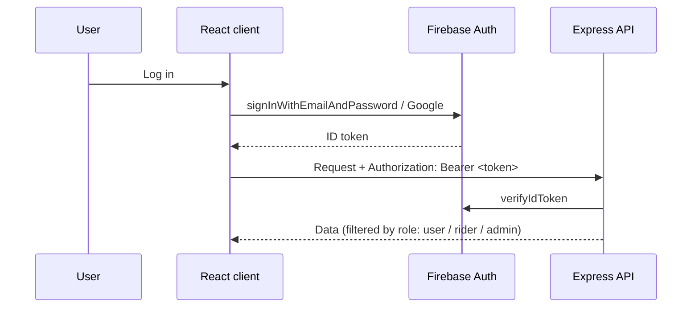
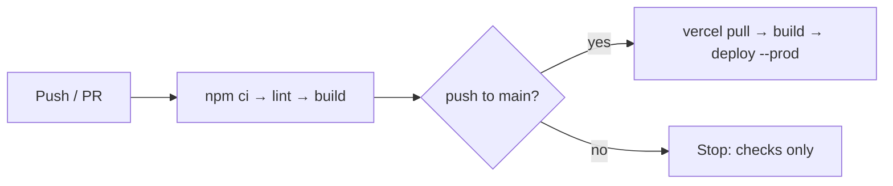

# ZapShift Client

[](https://github.com/hossenra/Zap-shift-client/actions/workflows/ci-cd.yml)

Frontend for **ZapShift**, a parcel delivery platform for Bangladesh. Customers book and pay for deliveries and track them live; riders manage their deliveries; admins approve riders and assign parcels.

Backend API: [Zap-shift-server](https://github.com/hossenra/Zap-shift-server)

## Features

**Customers**
- Sign up / log in with email or Google (Firebase Authentication)
- Book a parcel with automatic price calculation by type, weight and district
- Pay with Stripe card payments and view payment history
- Track a parcel through its full status timeline
- Coverage map of all service centers (Leaflet)
- Apply to become a rider

**Riders**
- See assigned (pending) deliveries and mark them delivered or failed
- View completed deliveries

**Admins**
- Approve, deactivate and manage riders
- Assign paid parcels to available riders in the right district
- Search users and grant or remove admin rights

Routes are protected on the client (`PrivateRoute`, `RiderRoutes`, `AdminRoutes`) and every API call is re-checked on the server with the user's Firebase ID token.

## Tech stack

| Area | Technology |
| --- | --- |
| Framework | React 19, Vite 7 |
| Routing | React Router 7 |
| Data fetching | TanStack Query, Axios (with auth interceptors) |
| Styling | Tailwind CSS 4, daisyUI |
| Forms | React Hook Form |
| Auth | Firebase Authentication |
| Payments | Stripe Elements |
| Maps | React Leaflet |
| CI/CD | GitHub Actions → Vercel |

## How auth works



`useAxiosSecure` attaches the token to every request and handles `401` (log out) and `403` (redirect to `/forbidden`) centrally.

## Run locally

Requirements: Node.js 20+ and the [server](https://github.com/hossenra/Zap-shift-server) running on port 4000.

```bash
git clone https://github.com/hossenra/Zap-shift-client.git
cd Zap-shift-client
npm install
cp .env.example .env.local   # then fill in your values
npm run dev
```

Open `http://localhost:5173`.

### Environment variables

| Variable | Description |
| --- | --- |
| `VITE_API_URL` | Backend URL, e.g. `http://localhost:4000` or `https://<service>.onrender.com` |
| `VITE_apiKey` … `VITE_appId` | Firebase web app config |
| `VITE_payment_key` | Stripe publishable key |
| `VITE_image_upload_key` | imgbb API key for profile pictures |

### Scripts

| Command | What it does |
| --- | --- |
| `npm run dev` | Start the dev server with hot reload |
| `npm run lint` | Run ESLint |
| `npm run build` | Production build to `dist/` |
| `npm run preview` | Serve the production build locally |

## CI/CD pipeline



Defined in [`.github/workflows/ci-cd.yml`](.github/workflows/ci-cd.yml):

1. **Lint & build** on every push and pull request; the `dist/` folder is kept as a build artifact
2. **Deploy** to Vercel production, only from `main` and only after step 1 passes

Vercel's own Git auto-deploy is turned off in `vercel.json`, so GitHub Actions is the single path to production. `vercel.json` also rewrites all paths to `index.html` so client-side routes like `/dashboard/myParcels` work on refresh.

### Deployment setup (one-time)

1. Install the CLI and link the project: `npm i -g vercel`, then `vercel link` in this folder. This creates `.vercel/project.json` (git-ignored) with your `orgId` and `projectId`.
2. In the Vercel dashboard → project → *Settings* → *Environment Variables*, add every variable from `.env.example` for **Production**, with `VITE_API_URL` set to the Render URL of the server.
3. Create a token at vercel.com → *Account Settings* → *Tokens*.
4. GitHub repo → *Settings* → *Secrets and variables* → *Actions* → add secrets `VERCEL_TOKEN`, `VERCEL_ORG_ID`, `VERCEL_PROJECT_ID`.
5. Firebase Console → *Authentication* → *Settings* → *Authorized domains* → add your `*.vercel.app` domain, otherwise login fails in production.

## Project structure

```
src/
├── contexts/      AuthContext + provider (Firebase user state)
├── firebase/      Firebase initialisation
├── hooks/         useAuth, useAxios, useAxiosSecure, useUserRole
├── layouts/       Root, Auth and Dashboard layouts
├── pages/         Home, Coverage, SendParcel, Authentication, Dashboard/*
├── router/        Route definitions
└── routes/        PrivateRoute, RiderRoutes, AdminRoutes guards
```
